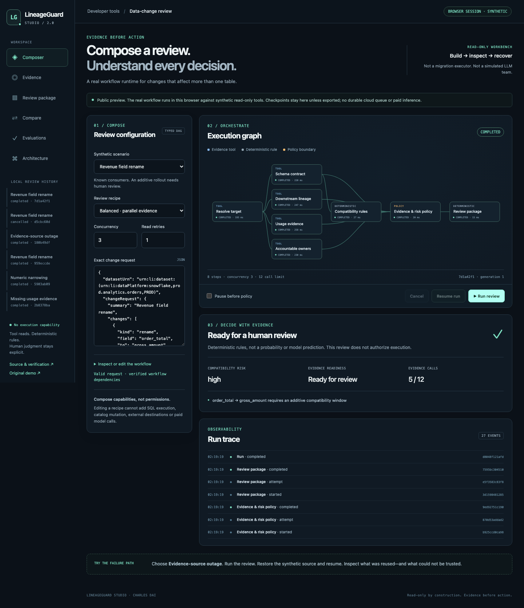

# LineageGuard Studio

**Compose a review. Understand every decision.**

[](https://github.com/ult666666/lineageguard-datahub-agent/actions/workflows/tests.yml)

[**Open Studio**](https://lineageguard-datahub-agent.vercel.app/) · [Architecture](docs/ARCHITECTURE.md) · [Verification](docs/VERIFICATION.md) · [Threat model](docs/THREAT_MODEL.md) · [Demo walkthrough](docs/DEMO_WALKTHROUGH.md)

LineageGuard Studio is a data-change review orchestrator built by Charles Dai with AI-assisted implementation. It compiles a typed workflow, gathers read-only evidence, applies deterministic compatibility and readiness rules, and produces an inspectable review package. The graph is the executable workflow—not a decorative trace assembled after a result.



## A reviewer can actually test this

**Compose.** Choose parallel, sequential or evidence-first recipes. Inspect the JSON graph, change bounded concurrency/retry settings, and see invalid dependencies or capabilities rejected before execution.

**Inspect.** Source identity, coverage, observation time and digests travel with each result. Compatibility risk and evidence readiness are separate: unknown usage is not zero, partial lineage is not complete, and a numeric type family does not prove a narrowing conversion safe.

**Interrupt and recover.** Pause before policy, reload, and resume. Cancel a run. Induce a source outage, restore the synthetic source, and resume the same identity. The runtime reuses only complete, digest-checked, still-fresh outputs under an unchanged binding.

**Compare and export.** Execute an additive alternative or a stricter policy and compare real results. Exports carry exact requests, recipe, policy, evidence, event chain and draft artifacts. A changed request invalidates old results and review notes.

**Evaluate.** Rerun named synthetic scenarios against the same interpreter, with expected and observed outcomes visible. The evaluation page does not replay a prerecorded pass table.

## Two runtimes, explicitly separated

| Surface | What runs | Where checkpoints live | What it does not claim |
| --- | --- | --- | --- |
| Public Studio | The shared browser DAG interpreter with same-origin synthetic tool calls | Current browser storage, unless exported | No durable cloud queue, live tenant, model inference or authenticated approval |
| Local Studio | The shared interpreter behind a loopback Node API | SQLite, with revision compare-and-swap and expiring writer leases | Not a distributed scheduler or multi-user authorization service |
| Optional DataHub capture | Two explicitly requested read-only MCP calls, followed by analysis against an immutable capture | A private, user-selected JSON export | No live-tenant validation in this release; no guessed graph edges or weekly usage |

There is **no SQL-execution or catalog-mutation capability** in the registry. A local acknowledgement is an unverified review note, not an organizational approval. Studio uses deterministic components; it does not pretend those components are an autonomous LLM team.

## Delivery

The [2.0 delivery guide](docs/RELEASE_2_0.md) gives exact local-stack commands, the five-minute demonstration, and the explicit deployed acceptance check. The public preview and local SQLite service are different runtimes, not interchangeable deployment claims.

## Run locally

Use **Node 24** (Node 22.13+ is also tested) and Python 3 for the preserved skill tests. The application has **zero runtime npm dependencies**. The two development dependencies are pinned browser-testing and formatting tools.

```sh
npm test
npm run studio:evaluate
npm run studio:local
```

Open `http://127.0.0.1:4183`. SQLite checkpoints are stored in the ignored `.lineageguard/` directory. Use an explicit private path for retained work:

```sh
npm run studio:local -- --port=4183 --store=/absolute/private/lineageguard-runs
```

`npm start` preserves the lightweight public-preview server at `http://127.0.0.1:4173`. The original interface remains at `/classic.html`; its historical scorer is not the Studio v2 evidence policy. The classic APIs and portable Codex skill remain available for compatibility.

### Command-line review

```sh
npm run studio:review -- --scenario=safe-add --output=./.lineageguard/review.json
```

Existing output files are never overwritten. An optional live capture requires **both** an explicit flag and a validated request file, plus locally configured `DATAHUB_MCP_URL` and `DATAHUB_MCP_TOKEN`:

```sh
npm run studio:review -- --live-datahub --request=./private-request.json --output=./.lineageguard/private-review.json
```

This mode is not invoked by the hosted demo, tests or evaluations. Keep tenant exports private. The capture deliberately supports the tested **MCP 2025-11-25 handshake profile**, not the different 2026-07-28 stateless lifecycle. Unsupported schema fields, unverified column paths or missing exact weekly usage remain incomplete evidence. A capture is a one-shot review input; it is not a background tenant synchronization service.

## Open, check or restart local Studio

The [local-launch update](docs/LOCAL_LAUNCH.md) makes repeat starts safe to understand. These commands require the launcher update after the original `v2.0.0` tag; the application and checkpoint format remain 2.0.0.

```sh
npm run studio:local   # Start if free; otherwise identify the compatible running service.
npm run studio:status # Read-only status, without opening the database or starting a server.
npm run studio:open   # Open the already-running service in your browser.
```

Leave the original server terminal open. Ctrl+C in that terminal stops it. The launcher does not kill another listener, silently change ports or substitute an explicitly requested storage directory. Status checks do not authenticate process ownership or prove a storage path.

## Engineering map

| Concern | Implementation | Concrete verification |
| --- | --- | --- |
| Typed composition | [`recipe.js`](public/studio/core/recipe.js) | Cycles, duplicate steps, required dependencies, unknown capabilities and budgets |
| Bounded orchestration | [`runtime.js`](public/studio/core/runtime.js) | Concurrency, retry accounting, deadlines, late results, cancellation and persistence failure |
| Evidence / compatibility | [`evidence.js`](public/studio/core/evidence.js), [`policy.js`](public/studio/core/policy.js) | Exact targets, missing/partial/stale evidence, narrowing and schema mismatch |
| Durable local state | [`store.mjs`](src/studio/store.mjs), [`service.mjs`](src/studio/service.mjs) | Real SQLite reopen, stale-writer fencing, simultaneous starts and interrupted-process recovery |
| MCP boundary | [`datahub-mcp-client.mjs`](src/datahub-mcp-client.mjs) | Response IDs, protocol/tool errors, deadlines, byte limits and read-only capabilities |
| Browser checkpoints | [`storage.js`](public/studio/storage.js) | Corruption preservation, quota failure, cross-tab conflicts and bounded history |
| Reproducible evaluation | [`evaluations.js`](public/studio/core/evaluations.js) | Named actual outcomes, recovery identity and corrupted-history refusal |
| Public release boundary | [`build-studio.mjs`](scripts/build-studio.mjs) | Exact static inventory, hashes, linked files, unexpected files and overwrite refusal |

## Verification commands

```sh
npm ci --ignore-scripts --no-audit --no-fund
npm test
npm run studio:evaluate
npx playwright install chromium
npm run test:browser
npm run build
node scripts/build-studio.mjs --verify dist
```

The build refuses an existing `dist/`; use a fresh checkout or remove only your own previous generated output after checking it. Browser tests exercise both runtime modes with synthetic data and block external requests. SQLite crash tests interrupt only a test-created child process in a temporary directory. See the [release evidence](docs/VERIFICATION.md) for actual counts, dates and limits.

## Design tradeoffs and limits

The runtime is intentionally domain-specific. Workflow JSON cannot execute arbitrary JavaScript, shell commands or SQL. This makes cancellation, reuse and policy review tractable. Hashes and a hash-linked event chain detect accidental changes; they are not signatures or defenses against a malicious same-origin/local owner. Browser persistence is not cloud durability. SQLite is a single-host store and the native Node binding's stability depends on the supported Node release.

Snowflake-style SQL is a **review draft**, with unsupported/destructive operations withheld or commented. It is not an atomic migration or a tested production rollback plan. A favorable review still requires owning teams to validate actual consumers and platform behavior.

The owner set the domain, budget, scope and approval boundaries. AI tools accelerated implementation and adversarial test design. This is an independent engineering project—not an enterprise adoption, customer engagement, investment strategy or claim of security certification.

## Project history

The original DataHub-context MVP and portable Codex skill are retained. Historical hackathon and demo provenance appears in [Classic project history](docs/CLASSIC_HISTORY.md); source code, recordings, submission documents and the Apache-2.0 license are preserved. Studio 2.0 is a subsequent engineering expansion, not a retroactive claim about the original submission.
