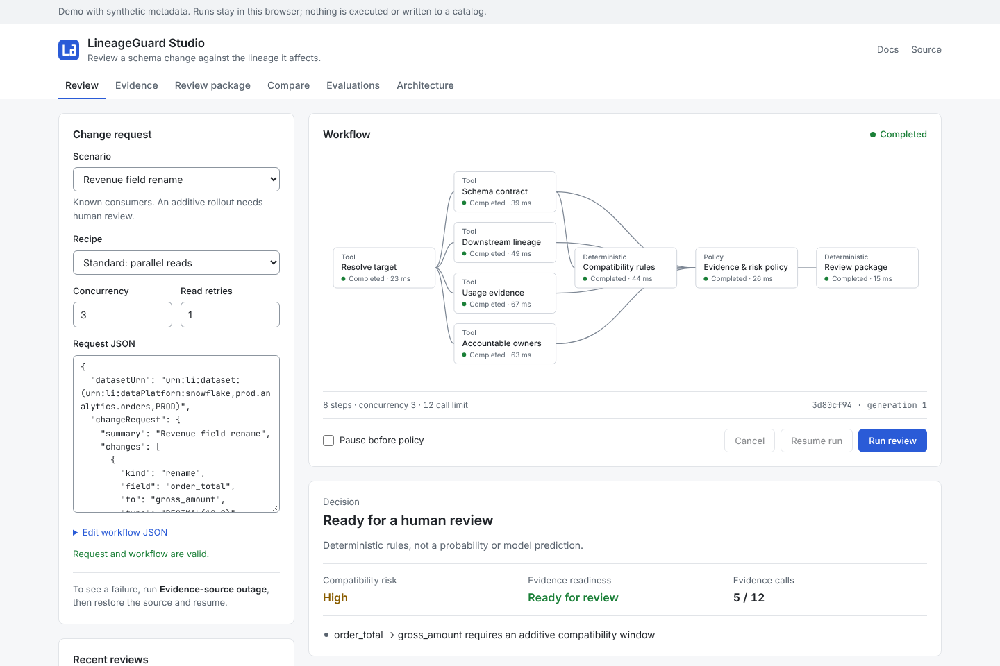
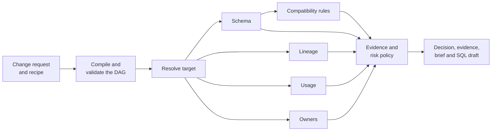

# LineageGuard Studio

Review a database schema change against the lineage it affects, before it ships.

[](https://github.com/ult666666/lineageguard-datahub-agent/actions/workflows/tests.yml)

Renaming `orders.order_total` looks harmless in one file, but a revenue table, a dashboard and the month-end close job may all read that column. LineageGuard Studio collects what is known about the column's consumers, applies fixed compatibility and evidence rules, and returns a decision with its reasons and a SQL draft for a person to review. When evidence is missing, the decision asks for it instead of assuming the change is safe.



## Try it

[Open the demo](https://lineageguard-datahub-agent.vercel.app/) to run reviews in your browser on synthetic metadata. To run it locally, use Node 24 (22.13 or later also works). There is nothing to install.

```sh
git clone https://github.com/ult666666/lineageguard-datahub-agent.git
cd lineageguard-datahub-agent
npm run studio:local
```

Open `http://127.0.0.1:4183`, pick a scenario and select **Run review**. To see a failure and a recovery, run **Evidence-source outage**, select **Restore synthetic source**, then **Resume run**.

## What it does

A review is a small workflow graph. Studio checks the graph before it runs, reads evidence under a call budget with bounded concurrency, retries and deadlines, and checkpoints every step. A run can be paused, cancelled or resumed after a source outage, and only complete evidence that is unchanged and still fresh is reused.

Compatibility risk and evidence readiness are judged separately. Unknown usage is not zero, partial lineage is not complete, and narrowing `BIGINT` to `SMALLINT` is blocked even though both are numeric. Each completed review ends in one of four decisions: `block`, `needs-evidence`, `review-required` or `proceed-with-checks`.

Evidence can come from:

- synthetic fixtures, which the demo and the tests use;
- a dbt `manifest.json`, read offline ([below](#review-against-a-dbt-manifest));
- a one-time, read-only capture from your own DataHub over MCP, which needs an explicit flag and your credentials.

A review exports as JSON, a Markdown brief and a SQL draft. The Review Inspector checks a saved export offline by recomputing its decision and drafts from the evidence inside it, and the Compare tab sets two saved reviews side by side or reruns the current one as an alternative plan.

## How it works



The graph on screen is the compiled workflow that runs. Each step's output is checked against its contract, hashed and checkpointed before dependent steps start. The same interpreter runs in two places: in the browser for the hosted demo, with checkpoints in browser storage, and behind a loopback Node API for `npm run studio:local`, with checkpoints in SQLite. Revision compare-and-swap and expiring writer leases keep a stale process from overwriting a newer one. No language model runs in the demo, the tests or the evaluations.

[Architecture](docs/ARCHITECTURE.md) covers the state machine, recovery, both runtimes and a map of the code.

## Review against a dbt manifest

Many data teams declare their lineage in dbt. LineageGuard reads a dbt [`manifest.json`](https://docs.getdbt.com/reference/artifacts/manifest-json) offline, plus [`catalog.json`](https://docs.getdbt.com/reference/artifacts/catalog-json) for observed column types if you have one, and maps them into the same evidence:

```sh
npm run studio:review -- \
  --dbt-manifest=public/studio/dbt/saas-analytics-warehouse/manifest.json \
  --dbt-catalog=public/studio/dbt/saas-analytics-warehouse/catalog.json \
  --request=examples/dbt/rename-mrr-usd.json \
  --output=./.lineageguard/dbt-review.json
```

The bundled files come from [saas-analytics-warehouse](https://github.com/ult666666/saas-analytics-warehouse), a synthetic dbt project. Renaming `fct_mrr.mrr_usd` lists the five models and two exposures downstream, with their owners. It also lists the 12 dbt tests that read the model. The decision stays at `needs-evidence`: a manifest records what a project declares, not query usage, nullability or consumers outside the project, so it can block a change or ask for more evidence but never clear one.

The Studio runs the same files as the **dbt manifest: column rename** scenario. The [dbt example](examples/dbt/README.md) shows the full output and how to point the command at your own project, and the [integration profile](docs/ARCHITECTURE.md#dbt-manifest-integration-profile) gives the mapping.

## Command line

```sh
npm run studio:review -- --scenario=safe-add --output=./.lineageguard/review.json
npm run studio:verify -- --file=./.lineageguard/review.json
node scripts/studio-compare.mjs --left=./.lineageguard/a.json --right=./.lineageguard/b.json
```

The first command runs a review without the UI, the second checks a saved review offline, and the third compares two saved reviews. Output files are never overwritten. [Command line](docs/COMMAND_LINE.md) covers every option, including the live DataHub capture and the local launcher.

## How it is tested

<!-- policy-benchmark:headline:start -->
On 105 labelled cases, no decision is more permissive than its label.
<!-- policy-benchmark:headline:end -->

CI runs on every push and pull request. The Node suite runs on Node 22 and 24 and includes seeded property tests and a test that kills a local run mid-review and resumes it. CI also checks the labelled policy benchmark against its pinned report and runs Chromium journeys through both runtimes with external requests blocked. The checks have caught bugs, such as policy decisions more permissive than their labels and a summary that could forge a decision line in the review brief.

```sh
npm ci --ignore-scripts --no-audit --no-fund
npm test                              # Node suite; the skill tests also need Python 3
npm run studio:evaluate               # named runtime scenarios
npm run studio:benchmark -- --check   # labelled benchmark against its pinned report
npx playwright install chromium
npm run test:browser                  # Chromium journeys in both runtimes
npm run build                         # static release in dist/; refuses to overwrite it
```

[Verification](docs/VERIFICATION.md) lists each claim with the check behind it, and the bugs the checks caught. [Evaluation](docs/EVALUATION.md) has the benchmark's labelling rules and full results.

## Limits

- Studio reviews and drafts, and never runs SQL or writes to a catalog; the SQL draft is not a tested migration or rollback plan.
- The demo and tests use synthetic metadata, and the DataHub capture is tested with injected tool results, not a live tenant.
- The dbt adapter reads manifest schema v12 only, and its lineage is model-level, not column-level.
- Hashes detect accidental changes but are not signatures, and an acknowledgement is a local note, not an approval.
- Durable state is one SQLite database on one host; browser checkpoints live only in that browser's storage.

## Docs

- [Architecture](docs/ARCHITECTURE.md): run semantics, recovery, runtimes, the DataHub and dbt profiles, trade-offs and a code map.
- [Verification](docs/VERIFICATION.md) and [Evaluation](docs/EVALUATION.md): what CI checks, and how the policy is measured.
- [Command line](docs/COMMAND_LINE.md), [local launcher](docs/LOCAL_LAUNCH.md), [Review Inspector](docs/REVIEW_INSPECTOR.md) and [saved-review comparison](docs/REVIEW_COMPARISON.md).
- [Threat model](docs/THREAT_MODEL.md), [demo walkthrough](docs/DEMO_WALKTHROUGH.md) and [delivery guide](docs/RELEASE_2_0.md).

## Project history

LineageGuard began as a DataHub-context agent for a hackathon, which is where the repository name comes from. The original MVP, its interface at `/classic.html` and the portable Codex skill in [`skills/`](skills/lineageguard-schema-review) are kept, and [Classic project history](docs/CLASSIC_HISTORY.md) covers them. Studio 2.0 is later work, not part of the original submission.

Built by Charles Dai with AI coding assistants, which sped up the implementation and the adversarial tests. I chose the problem and set its scope and approval boundaries.

Licensed under [Apache-2.0](LICENSE).
