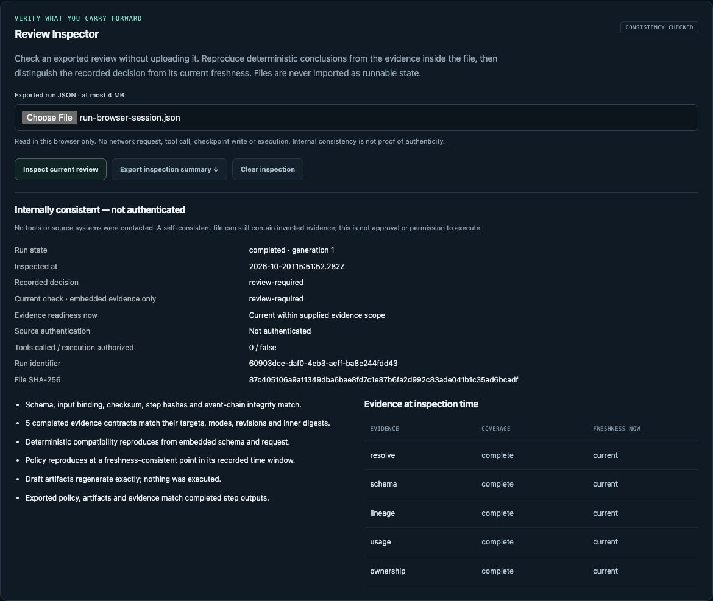

# LineageGuard Studio

**Stop breaking schema changes before they reach production.**

[](https://github.com/ult666666/lineageguard-datahub-agent/actions/workflows/tests.yml)

[**Open Studio**](https://lineageguard-datahub-agent.vercel.app/) · [Architecture](docs/ARCHITECTURE.md) · [Verification](docs/VERIFICATION.md) · [Threat model](docs/THREAT_MODEL.md) · [Demo walkthrough](docs/DEMO_WALKTHROUGH.md)

A schema change can look harmless in one file and still break the tables, dashboards and models that read from it. LineageGuard Studio reviews a proposed change before it ships. It gathers read-only evidence about what depends on the changed data, applies deterministic compatibility and readiness rules, and produces a review package with the decision, the evidence behind it and a draft migration. Charles Dai built it with AI-assisted implementation.

- **What runs:** a typed workflow engine and deterministic policy code, either in your browser (the public demo) or in a local Node service backed by SQLite. The workflow graph is the program that runs, not a trace drawn afterwards. No language model runs in the demo, the tests or the evaluations, and Studio never executes SQL or changes a catalog.
- **What is optional:** a read-only capture from your own DataHub instance, which needs an explicit flag and your own credentials, and the portable Codex skill in [`skills/`](skills/lineageguard-schema-review), which lets an AI coding agent run a schema review with a deterministic Python scorer. The repository name comes from the original DataHub-context agent; see [Project history](#project-history).


## A reviewer can actually test this

**Compose.** Choose parallel, sequential or evidence-first recipes. Inspect the JSON graph, change bounded concurrency/retry settings, and see invalid dependencies or capabilities rejected before execution.

**Inspect.** Source identity, coverage, observation time and digests travel with each result. Compatibility risk and evidence readiness are separate: unknown usage is not zero, partial lineage is not complete, and a numeric type family does not prove a narrowing conversion safe.

**Interrupt and recover.** Pause before policy, reload, and resume. Cancel a run. Induce a source outage, restore the synthetic source, and resume the same identity. The runtime reuses only complete, digest-checked, still-fresh outputs under an unchanged binding.

**Compare and export.** Execute an additive alternative or a stricter policy and compare real results. Exports carry exact requests, recipe, policy, evidence, event chain and draft artifacts. A changed request invalidates old results and review notes.

**Evaluate.** Rerun named synthetic scenarios against the same interpreter, with expected and observed outcomes visible. The evaluation page does not replay a prerecorded pass table.

## Two runtimes, explicitly separated

| Surface | What runs | Where checkpoints live | What it does not claim |
| --- | --- | --- | --- |
| Public Studio | The shared browser DAG interpreter with same-origin synthetic tool calls | Current browser storage, unless exported | No durable cloud queue, live tenant, model inference or authenticated approval |
| Local Studio | The shared interpreter behind a loopback Node API | SQLite, with revision compare-and-swap and expiring writer leases | Not a distributed scheduler or multi-user authorization service |
| Optional DataHub capture | Two explicitly requested read-only MCP calls, followed by analysis against an immutable capture | A private, user-selected JSON export | No live-tenant validation in this release; no guessed graph edges or weekly usage |

There is **no SQL-execution or catalog-mutation capability** in the registry. A local acknowledgement is an unverified review note, not an organizational approval.

## Delivery

The [2.0 delivery guide](docs/RELEASE_2_0.md) gives exact local-stack commands, the five-minute demonstration, and the explicit deployed acceptance check.

## Run locally

Use **Node 24** (Node 22.13+ is also tested) and Python 3 for the preserved skill tests. The application has **zero runtime npm dependencies**. The two development dependencies are pinned browser-testing and formatting tools.

```sh
npm test
npm run studio:evaluate
npm run studio:local
```

Open `http://127.0.0.1:4183`. SQLite checkpoints are stored in the ignored `.lineageguard/` directory. Use an explicit private path for retained work:

```sh
npm run studio:local -- --port=4183 --store=/absolute/private/lineageguard-runs
```

`npm start` preserves the lightweight public-preview server at `http://127.0.0.1:4173`. The original interface remains at `/classic.html`; its historical scorer is not the Studio v2 evidence policy. The classic APIs and portable Codex skill remain available for compatibility.

### Command-line review

```sh
npm run studio:review -- --scenario=safe-add --output=./.lineageguard/review.json
```

Existing output files are never overwritten. An optional live capture requires **both** an explicit flag and a validated request file, plus locally configured `DATAHUB_MCP_URL` and `DATAHUB_MCP_TOKEN`:

```sh
npm run studio:review -- --live-datahub --request=./private-request.json --output=./.lineageguard/private-review.json
```

The hosted demo, tests and evaluations never use this mode. Keep tenant exports private. A capture is a one-shot review input, not a background sync: unsupported schema fields, unverified column paths and missing weekly usage stay marked as incomplete evidence. The [DataHub integration profile](docs/ARCHITECTURE.md#datahub-integration-profile) lists the supported MCP protocol version.

## Inspect a review after export

**Review package → Review Inspector** checks saved JSON without uploading it or importing a runnable checkpoint. It verifies hashes and evidence contracts, reproduces deterministic conclusions and draft artifacts, and separates the recorded decision from the embedded evidence's freshness at inspection time. The same guard protects JSON, Markdown and SQL-draft exports. A passing inspection means the package is internally consistent, not that it is authentic or approved.

**Compare two saved exports offline:** open **Compare → Compare saved reviews**, select the left and right JSON files and choose **Compare saved exports**. Both packages must pass the Inspector before any result appears, and the report can be downloaded or cleared without changing the current review. The command-line version applies the same check:

```sh
node scripts/studio-compare.mjs --left=/path/left.json --right=/path/right.json
```

It shows recorded policy and evidence differences without importing, calling tools, writing to a store or executing anything. Follow the [synthetic standard/strict walkthrough and command contract](docs/REVIEW_COMPARISON.md).

```sh
npm run studio:verify -- --file=/absolute/path/to/export.json
```



The [Inspector guide](docs/REVIEW_INSPECTOR.md) explains offline operation, file bounds, replay semantics and adversarial tests. The Inspector was added on `main` after the `v2.0.0` tag.

## Open, check or restart local Studio

The [local-launch guide](docs/LOCAL_LAUNCH.md) explains what happens on a repeat start. These commands were added on `main` after the `v2.0.0` tag; the checkpoint format did not change.

```sh
npm run studio:local   # Start if free; otherwise identify the compatible running service.
npm run studio:status # Read-only status, without opening the database or starting a server.
npm run studio:open   # Open the already-running service in your browser.
```

Leave the original server terminal open. Ctrl+C in that terminal stops it. The launcher does not kill another listener, silently change ports or substitute an explicitly requested storage directory. Status checks do not authenticate process ownership or prove a storage path.

## Engineering map

| Concern | Implementation | Concrete verification |
| --- | --- | --- |
| Typed composition | [`recipe.js`](public/studio/core/recipe.js) | Cycles, duplicate steps, required dependencies, unknown capabilities and budgets |
| Bounded orchestration | [`runtime.js`](public/studio/core/runtime.js) | Concurrency, retry accounting, deadlines, late results, cancellation and persistence failure |
| Evidence / compatibility | [`evidence.js`](public/studio/core/evidence.js), [`policy.js`](public/studio/core/policy.js) | Exact targets, missing/partial/stale evidence, narrowing and schema mismatch |
| Saved review comparison | [`review-comparison.js`](public/studio/core/review-comparison.js) | Shared browser/CLI validation of both exports, explicit alternatives and recorded/current decisions, stale-read and no-upload browser checks |
| Offline review inspection | [`inspection.js`](public/studio/core/inspection.js) | Rehashed projection drift, policy/artifact replay, stale evidence, local-only file handling and no-upload browser checks |
| Durable local state | [`store.mjs`](src/studio/store.mjs), [`service.mjs`](src/studio/service.mjs) | Real SQLite reopen, stale-writer fencing, simultaneous starts and interrupted-process recovery |
| MCP boundary | [`datahub-mcp-client.mjs`](src/datahub-mcp-client.mjs) | Response IDs, protocol/tool errors, deadlines, byte limits and read-only capabilities |
| Browser checkpoints | [`storage.js`](public/studio/storage.js) | Corruption preservation, quota failure, cross-tab conflicts and bounded history |
| Reproducible evaluation | [`evaluations.js`](public/studio/core/evaluations.js) | Named actual outcomes, recovery identity and corrupted-history refusal |
| Public release boundary | [`build-studio.mjs`](scripts/build-studio.mjs) | Exact static inventory, hashes, linked files, unexpected files and overwrite refusal |

## Verification commands

```sh
npm ci --ignore-scripts --no-audit --no-fund
npm test
npm run studio:evaluate
npx playwright install chromium
npm run test:browser
npm run build
node scripts/build-studio.mjs --verify dist
```

The build refuses an existing `dist/`; use a fresh checkout or remove only your own previous generated output after checking it. Browser tests exercise both runtime modes with synthetic data and block external requests. SQLite crash tests interrupt only a test-created child process in a temporary directory. See [Verification](docs/VERIFICATION.md) for what CI runs and what the checks cover.

## Design tradeoffs and limits

The runtime is intentionally domain-specific. Workflow JSON cannot execute arbitrary JavaScript, shell commands or SQL. This makes cancellation, reuse and policy review tractable. Hashes and a hash-linked event chain detect accidental changes; they are not signatures or defenses against a malicious same-origin/local owner. Browser persistence is not cloud durability. SQLite is a single-host store and the native Node binding's stability depends on the supported Node release.

Snowflake-style SQL is a **review draft**, with unsupported/destructive operations withheld or commented. It is not an atomic migration or a tested production rollback plan. A favorable review still requires owning teams to validate actual consumers and platform behavior.

The owner set the domain, budget, scope and approval boundaries, and AI tools sped up implementation and adversarial test design. This is an independent engineering project, not a customer deployment or a security certification.

## Project history

The original DataHub-context MVP and the portable Codex skill are retained. [Classic project history](docs/CLASSIC_HISTORY.md) covers the hackathon and demo provenance, and the original submission notes and demo scripts are in [`docs/history/`](docs/history/). Source code, recordings and the Apache-2.0 license are preserved. Studio 2.0 is a later engineering expansion, not a retroactive claim about the original submission.
