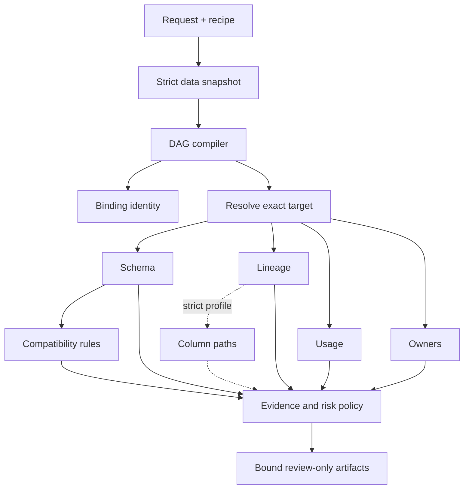
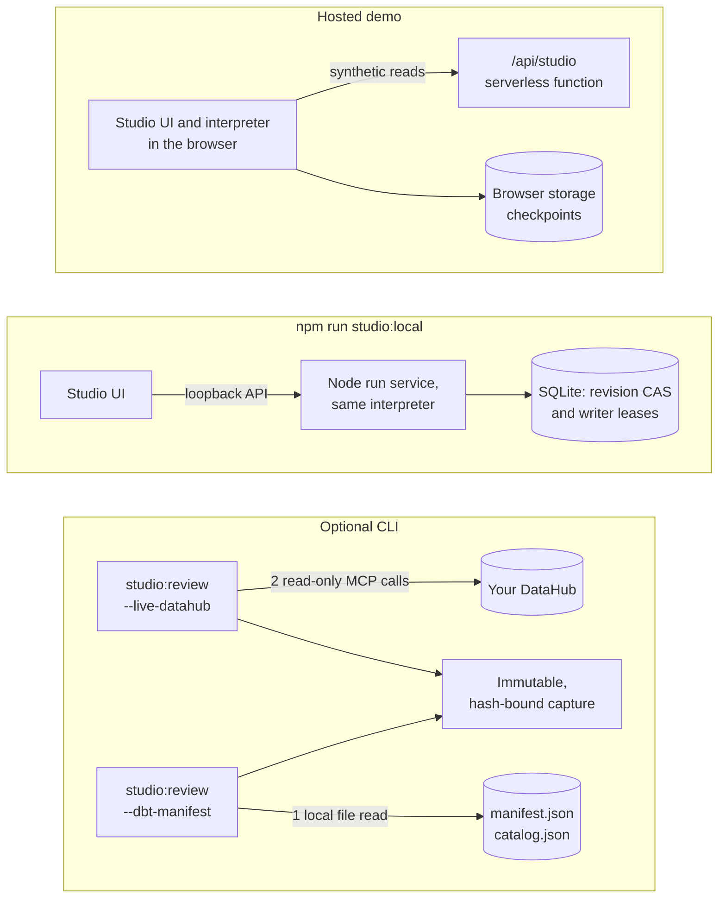

# Studio 2.0 architecture and run semantics

## Product contract

A review is a reproducible decision artifact, not a command to mutate a system. The input is a bounded data-change request and a typed recipe. The output separates compatibility risk, evidence readiness and a review-only artifact package. The public application has no model credentials, tenant credentials, migration executor or arbitrary tool registry.

## Component graph

The compiler computes topological levels from actual dependencies. The visual graph is rendered from that compiled result. It rejects unknown operations, duplicate nodes, missing required evidence dependencies and cycles. The registry is fixed code, not dynamically supplied executable functions. Independent tool reads can run concurrently; deterministic analysis and policy wait for their declared inputs.

## Where it runs

Both runtimes execute the same modules in `public/studio/core`. The hosted demo keeps checkpoints in the browser; the local service keeps them in SQLite. The optional CLI reads DataHub, or a dbt manifest, once and then reviews the frozen capture with the same interpreter. The Studio's dbt scenario reads a bundled static manifest locally in both runtimes; the synthetic tool API refuses it. Exported reviews can be checked offline by the Review Inspector, which never calls a tool.

| Surface | What runs | Where checkpoints live | What it does not claim |
| --- | --- | --- | --- |
| Public Studio | The shared browser DAG interpreter with same-origin synthetic tool calls | Current browser storage, unless exported | No durable cloud queue, live tenant, model inference or authenticated approval |
| Local Studio | The shared interpreter behind a loopback Node API | SQLite, with revision compare-and-swap and expiring writer leases | Not a distributed scheduler or multi-user authorization service |
| Optional DataHub capture | Two explicitly requested read-only MCP calls, followed by analysis against an immutable capture | A private, user-selected JSON export | No live-tenant validation in this release; no guessed graph edges or weekly usage |
| Optional dbt manifest | Offline analysis of a local `manifest.json` and optional `catalog.json`, captured once into the same immutable evidence | A user-selected JSON export | No query usage, nullability, column lineage or consumers outside the project; those stay evidence gaps |

The registry has no SQL-execution or catalog-mutation capability. A local acknowledgement is an unverified review note, not an organizational approval.

## Identity and data contracts

`contract.js` snapshots bounded plain JSON without calling getters or `toJSON`. It rejects poison keys, cycles, symbols, hidden fields, unsupported numbers and extended/sparse arrays. The request validates simple SQL identifiers and an intentionally conservative scalar type subset. The recipe limits concurrency, retries, calls and deadlines.

A run binding hashes the normalized request, complete recipe, source mode and revision, scenario context, policy version and application version. Each completed output has its own digest. Evidence envelopes contain the exact target, evidence kind, observation time, source identity, completeness and typed data. The whole checkpoint has a checksum, and events form a hash-linked chain.

These hashes detect corruption and accidental mismatches. They do not authenticate a source or defend against an attacker able to rewrite the whole browser/local record. There is no server endpoint for accepting an arbitrary imported run as authority.

## Execution state machine

A new run begins as `created`. An execution generation moves it to `running` and may settle as `completed`, `paused`, `failed` or `cancelled`. Each registered step is `pending`, `running`, `completed`, `failed` or `cancelled`.

A serialized commit queue changes state, appends an event, computes the checkpoint checksum and awaits persistence. Work is not dispatched past a failed checkpoint write. The interpreter does not emit a success result merely because an HTTP request returned or because a process disappeared.

Tool operations have a read-call budget and bounded retry count. Only declared transient source errors and timeouts are retried. Every attempt is counted. A run deadline and per-step deadline use cancellation signals plus a bounded promise race. A late tool result cannot become completed evidence after cancellation. The call budget counts logical evidence-adapter invocations, not TCP packets, protocol initialization or every underlying MCP request.

The default recipe allows concurrency 3, 12 logical read calls and one retry per read. Users may lower or adjust values only within the compiler's hard limits. Deterministic and policy steps do not consume evidence calls. A pause before policy waits until running reads settle; it is a checkpoint boundary rather than a claim that JavaScript execution was suspended mid-statement.

## Recovery and valid reuse

Resume preserves the run ID and increments its generation. It verifies the complete checkpoint, binding, event chain and output digests before dispatch. Source-revision changes require a new review. Previously running, failed or cancelled steps are reset. Completed tool outputs are reused only while current under the selected policy's freshness limit. Invalidated outputs invalidate their dependent steps transitively.

The read-call budget is cumulative across generations. Resume is not a way to replenish a depleted budget. A restored synthetic source changes its availability, not its evidence revision; this makes outage recovery demonstrable without silently substituting a different data snapshot.

In the UI, editing the request or the recipe discards the displayed result and any comparison built on it, so an old decision or review note never sits next to new inputs.

The local UI waits for the new execution generation after a resume request. A `202 Accepted` response may precede its first durable state transition; returning the old paused checkpoint is not proof that the resumed generation finished. A browser regression reproduced and closed this race.

## Two persistence implementations

**Browser session.** One localStorage value holds up to six verified runs. A write checks the previously read value, takes a Web Lock where supported, then performs one set/read-back operation. Corrupt data is preserved and surfaced, not silently deleted. Quota failures stop progress. Another tab's change produces a conflict and requires reload. Without Web Locks, the fallback comparison is cooperative rather than a cross-process atomic transaction. Browser storage can be cleared or unavailable, so the UI labels this mode explicitly and supports exports.

**Durable local service.** Native SQLite stores a payload, monotonic revision counter, writer lease and update time. WAL mode and `synchronous=FULL` are used. A transaction bounds record count at creation. Saves require the expected revision, matching writer and an unexpired lease. After lease takeover, the old writer cannot commit. Admission reservations prevent simultaneous asynchronous starts from exceeding the local active-run limit or creating phantom accepted runs. This is a single-host coordinator that trusts its clock and local filesystem, not a distributed queue or authenticated multi-tenant service.

A local process interruption leaves the last committed checkpoint. Recovery is explicit after the prior lease expires. The process-recovery test interrupts only its own test child and then verifies the same ID, a new generation, reused completed evidence and no false terminal success.

## Evidence policy

Compatibility is not an opaque composite score. Drops, required additions without validated backfill, numeric narrowing, unsupported conversions, source-schema mismatches and nullability tightening are blocking findings. Renames and supported widening require review. Column names compare case-insensitively, because unquoted identifiers do on mainstream warehouses, and a rename that declares a type is also judged as a type change. The [labelled benchmark](EVALUATION.md) measures these rules against labels written from stated rules. An optional additive field can proceed only with explicit validation checks and adequate evidence.

Evidence readiness is independent: missing, stale, future-dated or incomplete required observations and missing owners prevent readiness. The stricter policy uses a shorter freshness window and requires explicit column paths. A partial lineage response never proves zero consumers. The graph shows supplied relationships only; flat reachable-asset results are not relabeled as exact graph edges.

The artifacts use validated identifiers and types. Unsupported or blocked operations are omitted or commented. SQL remains a dialect-specific review draft, not a verified migration or atomic rollback transaction. A local acknowledgement binds the current review but sets `executionAuthorized=false` and labels its identity `local-unverified`.

## Portable review inspection

The Review Inspector is separate from checkpoint admission and execution. It takes bounded JSON bytes or a copied review object, checks existing integrity bindings, validates completed evidence, reproduces compatibility/policy/artifacts, and checks the final result projection. Its browser surface does not upload or save the file, and the CLI never opens SQLite. Current policy is evaluated against embedded evidence at the displayed inspection time, not against a newly fetched source.

Because policy freshness is time-dependent, recorded-policy replay tests its declared start/end and each relevant freshness transition within that window. This is consistency with declared evidence and timestamps, not proof of a real-world event history. The report explicitly denies source authentication, execution authorization and resumable import. Standard Studio artifact exports now pass through this semantic check too. See [REVIEW_INSPECTOR.md](REVIEW_INSPECTOR.md) for the full boundary and reproducible commands.

## DataHub integration profile

The MCP client implements the explicitly tested 2025-11-25 handshake profile, including initialization, session identifiers and tool execution. It binds JSON-RPC response IDs, skips requests and notifications the server starts on the response stream (it declares no client capabilities and answers none of them), distinguishes protocol errors from tool errors, enforces deadlines and response sizes, refuses redirects and constrains tools to an explicit read-only list. MCP 2026-07-28 has a different stateless lifecycle and is not claimed compatible.

The optional Studio CLI captures `get_entities` and `get_lineage` once, then runs against an immutable hash-bound capture. It does not hide repeated live reads inside the DAG. Only recognized scalar schema metadata and exact seven-day usage become complete evidence; 30-day usage is not automatically relabeled as exact weekly activity. Unknown column paths stay unknown. This bridge is tested with injected structured tool results. No real tenant was connected or validated for the Studio release.

## dbt manifest integration profile

[`dbt-manifest.js`](../public/studio/core/dbt-manifest.js) turns a dbt
[`manifest.json`](https://docs.getdbt.com/reference/artifacts/manifest-json) and an optional
[`catalog.json`](https://docs.getdbt.com/reference/artifacts/catalog-json) into the same immutable, hash-bound capture as the DataHub bridge. It is a pure module, so the CLI, the local service and the browser share it. It never runs dbt, connects to a warehouse or parses SQL.

**Parse and verify.** Only `metadata.dbt_schema_version` manifest v12 (dbt Core 1.8 and later) and catalog v1 are accepted; any other version, or another artifact such as `run_results.json`, is refused with a message that names what was found. Every resource must carry its own `unique_id`, a `resource_type` that matches the ID prefix and a name. Reads use own data properties only, so accessors and prototype keys are never consulted. The adapter then checks that the three descriptions of the graph agree: `parent_map[x]` must equal `x.depends_on.nodes` for every resource, and `child_map` must be exactly the inverse of `parent_map`. A topological sort must consume every node, because dbt refuses cyclic projects. Any disagreement, unknown ID, self edge or cycle refuses the file as `MANIFEST_INCONSISTENT`. A catalog table that lists a column name twice is refused, so key order cannot choose a column's type. Bounds: 128 MB per file, 250,000 resources, 4,000,000 map edges and 5,000 columns per relation.

**Resolve the target.** A request names a relation as `urn:li:dataset:(urn:li:dataPlatform:dbt,<database>.<schema>.<alias>,PROD)`. The relation must match exactly one model, seed, snapshot or source, compared case-insensitively. Ephemeral models have no relation and cannot be targets. Relation parts must be simple unquoted identifiers, because the relation becomes the table name in the SQL draft.

**Map the evidence.**

| Evidence | From the manifest | Coverage |
| --- | --- | --- |
| Resolve | The relation and `metadata.adapter_type` | Complete |
| Schema | `catalog.json` columns and types when the catalog has the target, otherwise `data_type` declarations; names or types outside the Studio vocabulary are left out | Partial, or unknown with no typed columns: nullability is not recorded, so every column is treated as nullable |
| Lineage | A breadth-first walk of the verified `child_map`, with `depends_on` edges between returned nodes. Models, seeds, snapshots and sources are datasets; exposures keep their type (`ml` becomes `model`); metrics, semantic models and saved queries are metrics. At most 200 nodes and 500 edges | Always partial: it lists consumers declared in this project only |
| Quality checks | Data tests and unit tests in the target's `child_map`, with test type, column and severity, as `lineage.data.checks` | Descriptive only; the policy never reads them |
| Usage | Nothing: dbt artifacts carry no query history | Unknown |
| Ownership | `meta.owner` on the node, then the owner of its group; exposures use `owner.name` or `owner.email` | Complete over the returned nodes; a node without an owner is a `MISSING_OWNER` gap |
| Column paths | Nothing: a manifest has no column-level lineage | Unknown |

The observation time of every kind is the manifest's `generated_at` (the catalog's for schema from the catalog), so a manifest generated two days ago is two-day-old evidence and fails the freshness rule. The revision hashes the profile, the manifest metadata, the target and every evidence body, so it does not depend on JSON formatting or key order.

**Why no gap can become clearance.** Usage is always unknown and lineage always partial, so `evidenceReady` is never true and the decision is `block` or `needs-evidence`. A `not_null` data test checks current rows; it is not a NOT NULL constraint, so it never marks a column non-nullable, and a request to tighten nullability stays blocked. Zero downstream dbt nodes is not zero consumers. Dropping the catalog removes observed columns, so a change can turn from `block` (the column exists) into `needs-evidence` (the column is not visible), but it can never clear.

**Trade-offs.** The adapter does not infer column lineage from compiled SQL: `select *` and macros read columns without naming them, and a partial guess would look like evidence. It does not use model contracts as observed nullability, because a manifest does not show that the contracted build ran. dbt Core writes the manifest without the warehouse, while the catalog needs a built warehouse; the catalog is optional so a review can still run from `dbt parse` alone, with weaker schema evidence.

**Limits.** Because the adapter does not parse model SQL, it cannot say which downstream model reads a given column. Column types need `catalog.json` or `data_type` declarations, and types outside the Studio's scalar vocabulary (for example DuckDB `HUGEINT` or Snowflake `TIMESTAMP_NTZ`) are left out. Relation names must be simple unquoted identifiers, so a BigQuery project ID with a hyphen is refused. The Studio reviews only the bundled manifest; your own manifest goes through the [command line](COMMAND_LINE.md#dbt-manifest). Files are read whole, up to 128 MB each.

## Trade-offs and limits

The runtime is domain-specific on purpose. Workflow JSON cannot execute arbitrary JavaScript, shell commands or SQL, which keeps cancellation, reuse and policy review tractable. Hashes and the hash-linked event chain detect accidental changes; they are not signatures or a defense against a malicious same-origin or local owner. Browser persistence is not cloud durability. SQLite is a single-host store, and the stability of the native Node binding depends on the supported Node release.

The Snowflake-style SQL is a review draft, with unsupported or destructive operations withheld or commented out. It is not an atomic migration or a tested production rollback plan. A favorable review still needs the owning teams to check their actual consumers and platform behavior.

## Repository and deployment boundaries

The stateless hosted API accepts only bounded compile, synthetic read and evaluation operations. It does not expose the SQLite service, filesystem paths or arbitrary network URLs. The local durable API binds loopback and checks Host/Origin before writes. Static publishing uses an exact file inventory; tests, SQLite databases, credentials and private artifacts do not enter the site build.

CI executes the core suite on Node 22 and 24, then the actual browser workflows and static-build checks on Node 24. CodeQL and secret scanning supplement these checks; none constitutes an absolute security guarantee. The original classic UI and portable skill remain available with explicitly historical scope.

## Code map

| Concern | Implementation | What the tests check |
| --- | --- | --- |
| Typed composition | [`recipe.js`](../public/studio/core/recipe.js) | Cycles, duplicate steps, required dependencies, unknown capabilities and budgets |
| Bounded orchestration | [`runtime.js`](../public/studio/core/runtime.js) | Concurrency, retry accounting, deadlines, late results, cancellation and persistence failure |
| Evidence and compatibility | [`evidence.js`](../public/studio/core/evidence.js), [`policy.js`](../public/studio/core/policy.js) | Exact targets, missing, partial or stale evidence, narrowing and schema mismatch |
| Saved review comparison | [`review-comparison.js`](../public/studio/core/review-comparison.js) | Shared browser and CLI validation of both exports, alternative requests, recorded and current decisions, stale reads and no uploads |
| Offline review inspection | [`inspection.js`](../public/studio/core/inspection.js) | Rehashed projection drift, policy and artifact replay, stale evidence, local-only file handling and no uploads |
| Durable local state | [`store.mjs`](../src/studio/store.mjs), [`service.mjs`](../src/studio/service.mjs) | SQLite reopen, stale-writer fencing, simultaneous starts and interrupted-process recovery |
| MCP boundary | [`datahub-mcp-client.mjs`](../src/datahub-mcp-client.mjs) | Response IDs, protocol and tool errors, deadlines, byte limits and read-only capabilities |
| Browser checkpoints | [`storage.js`](../public/studio/storage.js) | Corruption preservation, quota failure, cross-tab conflicts and bounded history |
| Reproducible evaluation | [`evaluations.js`](../public/studio/core/evaluations.js) | Named outcomes, recovery identity and corrupted-history refusal |
| Property and hostile-input tests | [`properties.test.mjs`](../test/studio/properties.test.mjs), [`hostile-metadata.test.mjs`](../test/studio/hostile-metadata.test.mjs) | Seeded generators for type, request, JSON and event-stream parsing, the compiler, policy invariants and SQL and Markdown output; hostile catalog text |
| Labelled policy benchmark | [`policy-benchmark.mjs`](../src/studio/policy-benchmark.mjs), [`policy-cases.json`](../evals/policy-cases.json) | Labelled decisions, reasons and gaps; per-outcome precision and recall; CI fails on any decision more permissive than its label |
| dbt manifest evidence | [`dbt-manifest.js`](../public/studio/core/dbt-manifest.js), [`trim-dbt-manifest.mjs`](../scripts/trim-dbt-manifest.mjs) | Version refusal, map consistency, cycles, hostile and oversized files, owner precedence, a differential lineage property and a lossless-trim comparison |
| Public release boundary | [`build-studio.mjs`](../scripts/build-studio.mjs) | Static inventory, hashes, linked files, unexpected files and overwrite refusal |
