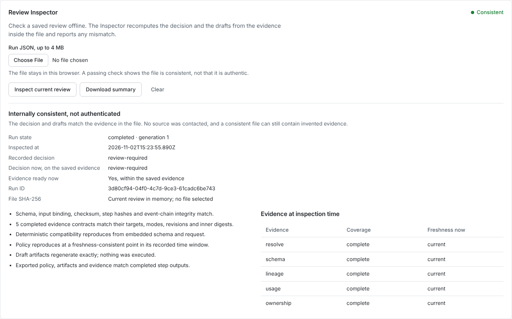

# Review Inspector

A review is only useful after it leaves Studio if someone else can check it. The Inspector checks an exported review on your own machine. It recomputes the decision and the drafts from the evidence inside the file and reports any mismatch. It does not import the review, connect to a catalog or approve anything.

## In Studio

Open the Review package tab and scroll to Review Inspector. Choose Inspect current review, or pick an exported run JSON file. The browser reads the file locally; nothing is uploaded or added to run history.



The panel shows two decisions side by side: the one recorded in the file, and the one the same evidence gives at the time you inspect it. An old review can be internally consistent and still need fresh evidence today. A failed or paused review stays incomplete; inspecting it never produces a favourable decision or resumes the run.

Download summary saves the run identity, hashes, check results and evidence freshness. It leaves out the SQL, the request summary, the target URN, the reviewer name and any catalog payload.

Clear empties the inspection view only. The active review and saved checkpoints stay as they were, and a file read that is still in flight cannot refill the view afterwards. Once Studio has loaded, the Inspector also works with the browser offline. Studio itself still has to be reachable to load; it is not an installable offline app.

To compare two completed reviews, use Compare saved reviews on the Compare tab, or the command in [Compare two saved reviews](REVIEW_COMPARISON.md). Both run this Inspector on each file first.

## From the terminal

The terminal check needs current `main`; the `v2.0.0` tag predates the Inspector. It needs no package installation, database or tenant.

```sh
npm run studio:verify -- --file=/absolute/path/to/export.json
node scripts/studio-inspect.mjs --file=/absolute/path/to/export.json --json
```

| Exit code | Meaning                                                                                                                                                  |
| --------- | -------------------------------------------------------------------------------------------------------------------------------------------------------- |
| 0         | Every internal consistency check passed. This does not mean the review is approved, authentic or safe to migrate, or that its evidence is still current. |
| 2         | The arguments, the file read or the review validation was refused.                                                                                       |

Error messages never repeat the file's contents, its path or error strings taken from the file. The command reads one regular file that has no other links, and never overwrites it. It writes no SQLite, opens no listener and calls no tool.

Input is limited to 4,000,000 bytes of UTF-8. A JSON object that repeats a key is refused, even when the repeats are spelled with different escapes, instead of silently keeping the last value. Structural limits reject objects that are too deep or too large, accessors, hidden fields and the keys `__proto__`, `prototype` and `constructor`. The file reader checks path links, that the file is a regular file, its size, and its metadata before and after reading, and it rejects directories, symlinks and FIFOs. None of this protects against someone who controls the operating system and can swap files or change the running process.

## What it checks

1. Checkpoint integrity: a supported schema, the binding between request and recipe, the checkpoint checksum, the hashes of completed outputs and the hash-linked event chain.
2. Evidence contracts: the requested target, the evidence kind, the source mode and revision, the declared coverage, size limits and each piece of evidence's own digest.
3. Deterministic results: the compatibility result follows from the embedded schema, the policy matches a freshness-consistent moment inside its recorded time window, and the drafts regenerate from their inputs.
4. Result projection: the exported policy, drafts and evidence equal the completed step outputs. Recomputing an outer checksum does not hide a mismatched result.
5. Current assessment: the policy is evaluated again at inspection time on the same embedded evidence. Sources are not read again, and the recorded and current decisions stay separate.

Policy replay considers every freshness change inside the policy step's recorded time window, not only its start and end. A regression test builds two evidence changes where the recorded policy is consistent only in the middle of the window, so a timestamp that crossed a boundary during the step does not cause a false rejection.

The same check runs before Studio exports run JSON, Markdown or SQL drafts. If the input changes during the check, the stale export is cancelled. The check never changes the stored workflow or runs the SQL.

## What a pass does not mean

A pass means the file is consistent with itself, not that it is authentic. SHA-256 digests and hash chains have no key, so they are not signatures: anyone who can rebuild a whole consistent package can rebuild its hashes too. A pass does not identify the author, confirm what the catalog really contains, prove the run happened as recorded, prove the evidence is complete or grant approval.

The Inspector calls the same policy and draft functions as Studio. It checks that replaying them gives the recorded results; it is not a second, independent implementation. An acknowledgement stays `local-unverified` with `executionAuthorized=false`, and every report sets `sourceAuthenticated=false`, `toolCalls=0` and `resumableImport=false`.

An inspected file never enters the runtime, the server store or the browser checkpoint store, and there is no upload or restore endpoint. The panel renders file content as text, never as HTML. Choosing an invalid file clears the previous successful report and disables its download, so an old pass cannot be mistaken for a new one.

The Inspector is version `1.0.0` with report schema `lineageguard.inspection/1`. The application, the policy, the original runtime interpreter, the database format and the `lineageguard.run/2` checkpoint schema stay at 2.0.0, and the tagged 2.0.0 release is unchanged.

## Tests

```sh
node --test test/studio/inspection.test.mjs test/studio/inspection-cli.test.mjs
npm test
npm run test:browser
npm run studio:evaluate
npm run build
node scripts/build-studio.mjs --verify dist
```

Build into a fresh output directory, because the builder refuses to overwrite `dist`. The public file inventory lists both Inspector modules. `npm run verify:deployed` is an opt-in check of the hosted copy, not part of offline CI: it compares the published bytes and runs the Inspector panel in a fresh synthetic browser session.

The unit tests cover tampering with and without a recomputed checksum, invented policy results and drafts, wrong evidence targets, digests and modes, stale and incomplete reviews, the strict policy, malformed encodings, duplicate keys, accessors, the command line writing nothing, and byte-for-byte preservation of the input.

The browser checks run the Inspector with networking disabled and confirm there are no requests and the local checkpoint bytes do not change. They also cover a late file read after Clear, a stale result being cleared, and the panel at 390, 768 and 1440 pixels wide. One test changes its own synthetic browser checkpoint to show that every draft export goes through the check, then restores the original bytes.
